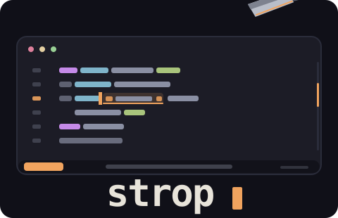

<div align="center">
  
  <h3>see the cut before you make it.</h3>
  <p>Neovim's hands · Helix's spine · rootle's eyes · GitLens' memory</p>
  <p>
    <a href="https://strop.dev">strop.dev</a> ·
    <a href="https://github.com/stropdev/strop/releases">what's new</a> ·
    <a href="https://crates.io/crates/strop-editor">crates.io</a>
  </p>
</div>


**strop** is a modal text editor in Rust with Vim-style commands, project
search, git surfaces and operator previews. Composition windows such as
`d/pattern` preview their affected ranges; completed object chords such as
`ci[` execute at the completing key rather than pausing for an inspection
step. Operator previews and execution consume the same resolver — the
preview cannot lie.

## Install

```sh
curl -fsSL https://strop.dev/install.sh | sh     # prebuilt static binary (linux/macOS)
brew install stropdev/tap/strop                  # homebrew (formula; macOS cask is prebuilt)
cargo install strop-editor --locked              # crates.io
mise use cargo:strop-editor                      # mise
```

Already installed? `strop update` self-updates tarball installs. Downloads,
SHA-256 verification and archive extraction run entirely in Rust; curl and
tar are not required.

Supported targets: Linux x86_64/aarch64 and macOS Apple Silicon (arm64).
Intel macOS is no longer supported starting with 0.36.0; installers,
self-update and remote worker admission refuse it rather than selecting an
ARM binary.

## The grammar in one card

```
h j k l w b e 0 ^ _ $ gg G %  motions          i a A o O            insert
d y c > < + motion/object     operators        dd yy cc D C Y s x   shortcuts
iw i" i' i( i[ i{             text objects     f t / ? n N          find & search
v V                           visual           u ctrl-r .           undo, redo, repeat
"a … "+                       registers        :w :q :e :help        ex line
Q                            multicursor      Space c              cursor below

Space  f files · o remote/containers · b buffers · / Search · R replace · ? help
Space w  - horizontal · v vertical · 1-9 focus · h/j/k/l/w move · q close
Space g  l log · h history · b blame gutter · y/o permalink · u/s/p hunk
```

`Space ?` lists every binding in the editor; `:help` explains each surface.

## The tour

- **The CLI** — `strop file.rs`, `strop remote ssh://user@host:2222/path`,
  `strop replay trace.jsonl`: one binary, subcommands for the occasional
  jobs, `strop help` for the whole map → **[docs/cli.md](docs/cli.md)**
- **Search and the query language** — one qualifier grammar
  (`language:cpp path:tests`, Boolean `AND`/`OR`/`NOT`) shared by file
  find, search/replace, symbols and the jump list →
  **[docs/search.md](docs/search.md)**
- **Editor surfaces** — themes, completion, structural + label-colon
  indentation, syntax, sessions → **[docs/editor.md](docs/editor.md)**
- **SSH, remote editing, containers** — read-only snapshots, explicit
  `:remote edit` write authority, remote LSP/Git/search, dev containers →
  **[docs/remote.md](docs/remote.md)**
- **Filesystem workspace** — directory browsing and Review → Apply →
  Receipt mutations, locally and over SSH →
  **[docs/filesystem.md](docs/filesystem.md)**
- **Terminals, headless scripts, traces** — real PTYs in splits, the
  scripted driver, and how to capture a reproducible bug →
  **[docs/terminal-and-scripting.md](docs/terminal-and-scripting.md)**

Also in `docs/`: [vim-compat.md](docs/vim-compat.md) (the differential
contract against nvim), [worker-protocol.md](docs/worker-protocol.md), and
[nucleo-decision.md](docs/nucleo-decision.md).

## The house rules

- **Async invariant**: input→render never crosses an `await`. Data sources
  (rg, git, LSP) are jobs posting onto the event loop — no exceptions.
- **Everything is a real buffer**: terminals, directory listings, search
  collections — every widget still knows how to be a text editor.
- **Zero-config single static binary**: no required setup, no downloads at
  runtime; grammars, queries and palettes are compiled in. rustls only —
  a dependency dragging in openssl is a bug.
- **Fidelity**: the vim grammar is the product; deviations are bugs, found
  by the differential harness against nvim, not by vibes.

Design contracts live in [plans/](plans/) — numbered, load-bearing, and
the authority for every behavior above.

## Reporting a bug

```sh
strop --log-file issue.jsonl path/to/file.rs
strop replay issue-full.jsonl        # full forensic replay
```

Details, content-privacy knobs and the input-only script extraction:
[docs/terminal-and-scripting.md](docs/terminal-and-scripting.md).
**Inspect logs before sharing** — they contain keys, commands and paths.

## Code signing policy

Public Windows executables and installers are approved manually and signed
through SignPath Foundation. The policy, privacy statement, build/provenance
controls and named approver live in [SECURITY.md](SECURITY.md).

## Links

- [strop.dev](https://strop.dev) — demo, palettes, install
- [plans/](plans/) — the numbered design contracts everything answers to
- [docs/](docs/) — the user-facing reference

MIT license · © 2026 [Tarek Nawara](https://github.com/tknawara)
