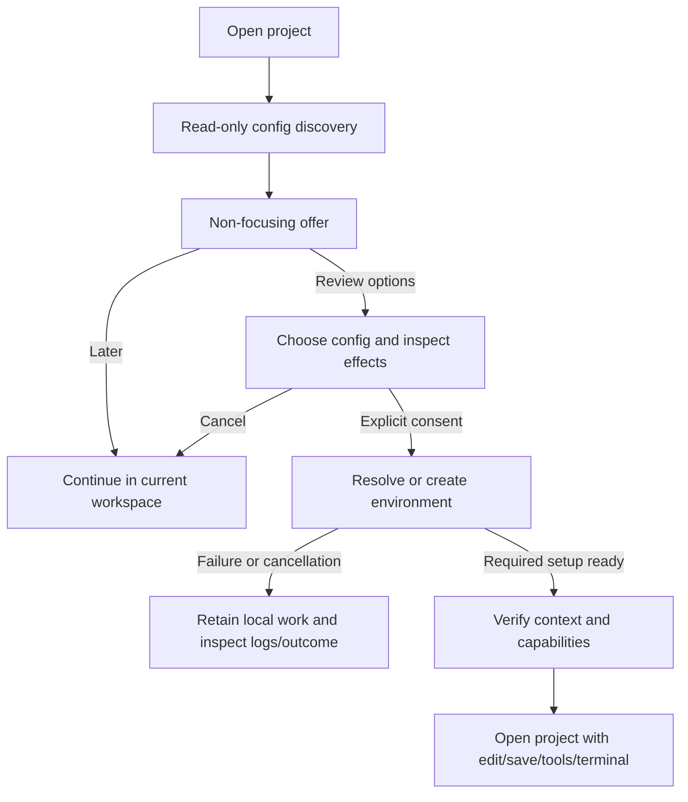

# 0081 — Product coherence: preview, workspaces, feedback and terminals

Status: **implemented in 0.48.0 (2026-11-05)**. The P0–P2 delivery slices are
complete: truthful terminal identity, durable feedback, live substitution
previews, terminal actions/quit review, read-only collections, namespace+root
workspaces, passive Dev Container discovery/trusted lifecycle and the admitted
container development loop. Remote engines, automatic port forwarding and
marketplaces remain explicitly out of scope. The critique and proposed design
below are retained as the baseline rationale and implementation contract.
Reviewed 2026-11-04 against the working source and the installed **Strop 0.47.4**.

Tarek requested a candid review of the editor's promise, remote/container
experience, devcontainer discovery, notifications and terminal integration,
including recommendations to cut landed features. This document proposes those
cuts; it does not mark existing commitments complete or silently repeal their
contracts. Read [AGENTS.md](../AGENTS.md) before implementation.

## 1. Verdict

**Strop has stronger correctness machinery than interaction coherence.** The
problem is not a shortage of features. It is that users must understand too many
internal distinctions before they can predict what an action will do, where it
will run, what it will change, and how to recover its result.

Three promises need to become observable:

1. **See the affected text before committing when the interaction permits it.**
   Sharing a resolver proves agreement; it does not prove that a user ever saw
   the resolved range. Ordinary completed Vim chords have no inspection interval.
2. **Know where you are working and what works there.** Namespace-safe resource
   identity is valuable, but a container browser is not a development workspace.
3. **Never lose an actionable result because you kept typing.** A single transient
   message cannot carry failures, permission decisions, progress and terminal
   instructions reliably.

The highest-risk concrete finding is not visual: **SSH terminals are implemented,
while the modeline labels all terminals `local`.** Fix execution identity before
adding more ways to execute remotely.

The strongest reduction: **retire search collections' live write-through editing
as a second multi-file mutation workflow.** Keep their useful source-backed
inspection, and consolidate deliberate bulk changes around the existing change
plan, review and receipt machinery.

Do not start with another theme, notification animation, provider framework,
terminal emulator rewrite, or a button that says “Reopen” but only opens `/` in a
read-only container.

### Keep the expensive work that is paying off

- Pure grammar resolution shared by preview and execution; revision/focus ownership.
- Async native work, bounded queues, typed refusals and stale-result rejection.
- Namespace and container-incarnation safety; no implicit local fallback.
- Reviewed filesystem changes, conditional saves and honest unconfirmed outcomes.
- The PTY/emulator/supervisor, child key ownership, pinned terminal inspection,
  paste consent, privacy boundaries and retained exited output.
- Real searchable buffers for results, explanations, proposals and receipts.
- Existing Search, theme/picker/pane improvements and retained LSP failures.

Plans [0065](0065-modal-terminal-experience-handoff.md),
[0075](0075-discoverable-search-remote-and-terminal.md),
[0076](0076-windows-safe-terminal-and-numbered-panes.md), and
[0080](0080-tui-hierarchy-and-density-handoff.md) already landed meaningful work.
Do not spend another implementation cycle rediscovering F2, terminal theming,
`:terminal-refresh`, the shared remote entry picker, or compact LSP badges.

## 2. Evidence and limits

**Observed** below means a launched executable, not an inference from a test.
**Source** means the current implementation/docs were inspected; it is not a
claim that an external integration was exercised. **Proposal** means a design
recommendation. Unmeasured consequences are explicitly marked `[INFERENCE]`.

The review used disposable files and isolated HOME/XDG directories. It launched
`strop headless` through the actual editor/service/render path and the interactive
TUI in an isolated tmux PTY. TUI captures included 100×30 and 48×16; headless
captures also included 100×24 and 80×16. Styled TUI captures were inspected.
The installed binary was not rebuilt from this checkout.

| Finding | Evidence |
| --- | --- |
| `d` displays a pending prefix; completing `dw` deletes immediately. Likewise `ci` has no resolved object and `[` commits `ci[` immediately. | Observed headless, with `ci[` also observed in the TUI. [README](../README.md) already discloses completing-key semantics. |
| `vi[` leaves the target visible and intact until `c`; `d/target` displays a real range and byte/inclusivity specification while composing. | Observed headless and styled TUI captures. These are genuine inspection opportunities. |
| `:%s/alpha/omega/g` shows original text until Enter, then substitutes. | Observed. [substitute_range](../crates/strop-engine/src/editor/normal/ex.rs) also uses literal `match_indices`, not the buffer-search grammar. |
| One Esc in `d/gamma` leaves the composed search open; a second Esc closes it and restores the origin. | Observed headless. The first transition is field Insert → field Normal, not cancellation. |
| Search replacement shows before/after rows and then a read-only proposal; Ctrl-O on the same results opens a separate editable collection. | Both surfaces observed with two local files. [Search docs](../docs/search.md) specify that collection edits update source buffers while typing. |
| A save to a child of a regular file reports `write failed: Io: Not a directory (os error 20)`; the next `h` clears the message. | Observed. [feed_inner](../crates/strop-engine/src/editor/mod.rs) clears `message` before dispatching the next semantic key. |
| Opening a file in a project with `.devcontainer/devcontainer.json` shows no discovery offer. Space o contains Add a host and Containers, not a project-specific action. | Observed in that fixture. A source search for `devcontainer`/`dev_container` across `crates/` found no implementation; [0037](0037-devcontainers-and-workspace-contexts.md) explicitly says provisioning is planned, not implemented. |
| Generic container attachment requests `/`, despite inspecting a container workdir. | Source: [attach_container](../crates/strop-engine/src/editor/containers.rs), [container identity](../crates/strop-containers/src/identity.rs). No live Docker attach was performed. |
| SSH terminals use the admitted remote worker; containers are refused. Every terminal's modeline namespace is nevertheless `local`. | Source: [terminal_worker / launch_terminal_at](../crates/strop-engine/src/editor/terminal/lifecycle.rs), [Modeline::gather](../crates/strop/src/render/statusline.rs). The [terminal guide](../docs/terminal-and-scripting.md) incorrectly groups SSH with refused container terminals. No SSH terminal was launched in this review. |
| Local terminal input, F2 inspection and returning with `i` work. At 48 columns the useful action hint clips to `terminal …` rather than retaining F2 or the return action. | Observed in the real TUI and headless. |
| Output can arrive while a snapshot remains pinned; search/yank inspect that snapshot; refresh updates it. Unsafe multiline paste is held and can be discarded; exit 0 retains output. | Observed headless using a real `/bin/sh` PTY. These are strengths, not missing features. |

No SSH server, Docker engine/container lifecycle, GUI frontend, release pipeline,
performance benchmark or Cargo test suite was exercised. Source-only findings
need their relevant live integration proof when implemented. Temporary fixtures
and captures are not retained as repository artifacts; reproduction recipes are
in §11. This handover does not claim release qualification.

## 3. A smaller product model

Expose three principal concepts, not the implementation's roster of workers,
permits, drafts, projections, proposals and receipts as unrelated features:

- **Workspace:** a selected project root in a named execution/filesystem context,
  with visible capabilities and authority. “SSH connected” is not the same as
  “tools enabled”; “tools enabled” is not blanket permission to write files.
- **Buffer/view:** text, source-backed results, terminal output, directory names
  or an explanation. Navigation, search and yank are consistent; mutability is
  explicit. **Real buffer must not mean writable buffer.**
- **Change:** an explicitly scoped action with a preview/review when possible,
  an application boundary, and an inspectable result. Buffers changing and files
  being saved are separate outcomes.

Unify presentation and admission, not fundamentally different side effects.
Text edits, filesystem publication and process execution must retain their own
safety contracts. A shell command is not dry-runnable just because it is shown in
an editor buffer. An unconfirmed remote write is not a retryable generic error.

Use existing doors:

- `Space o`: workspace/destination choices, including the current workspace's
  environment options; not a second Dev Containers dashboard.
- `Space a` in Normal: contextual actions for the actual focused surface. Today
  [context_actions](../crates/strop-engine/src/editor/filesystem/actions.rs)
  dispatches Directory actions or LSP actions; extend that owner to terminals,
  pending decisions and workspace-related contexts rather than creating parallel
  command registries.
- `:explain`: inspect why a capability is unavailable, relevant current state,
  retained failures and links to existing operation receipts/logs.

Expert Ex commands can remain precise implementation entry points where useful.
The ordinary journey should not require memorizing `:remote worker`,
`:container-worker`, `:remote edit` and `:terminal-local` before understanding
what the editor is offering.

## 4. Editing: make the preview promise precise and useful

### 4.1 The unavoidable grammar tradeoff

[0001 §2.1](0001-vision-and-design.md) promised “perfect” previews for ordinary
motion/object chords. That is stronger than the interaction can support.
Before the `w` in `dw`, the motion is unknown; after it, faithful Vim execution
has already happened. Before `[` in `ci[`, the object is unknown. A post-edit
flash, faster resolver or one-frame paint cannot give a person an inspection
and cancellation opportunity.

**Decision:** preserve the documented completing-key Vim behavior. Make Visual
selection the prominent, supported inspect-first path; do not add a timer or
confirmation to every edit, guess the unfinished object, or silently switch to
Helix's grammar.

| Operation class | Honest preview contract |
| --- | --- |
| Immediate `dw`, `ci[`, `dfx`, `.` | Execute on completion. No guaranteed human inspection interval. Candidate highlights for `f` are not a preview of a chosen cut. |
| `vi[` then `c`, other Visual selections | Inspect selection before the operator; all relevant cursors/ranges must be visible or summarized. |
| `d/pattern` while composing | Live affected range and semantics before Enter; cancellation must be understandable. |
| `:s` while composing | Add an actual before/after preview; this interaction already has an explicit Enter boundary. |
| Project replace, filesystem mutations, multi-file machine edits | Review exact targets and outcomes before application; saving/publication remains explicit. |
| Macros and arbitrary child/shell execution | No general effect preview. State that boundary in help; do not simulate a trustworthy preview. |

Teach `ci[` versus `vi[` then `c` side by side in the existing onboarding/demo
surfaces. The distinction is not a failure of Vim grammar; advertising both as
pre-commit previews is a product-contract failure. Keep the tagline, but define
its scope honestly. If an always-inspectable verb-first mode is desired later,
it is a separate grammar decision with explicit acceptance, not a preview fix.

### 4.2 Fix `:s` before expanding the feature list

This is the clearest missing opportunity: the user is already composing a
complete replacement before pressing Enter.

- Replace the standalone literal substitution parser/executor with a shared,
  bounded substitution plan. Preview and execution consume the same parsed
  command, source revision, range, matches and replacements.
- Reuse the current buffer-search grammar/semantics where applicable. Do not add
  another regex engine or blindly implement the historical 0001 regex subset:
  [current search documentation](../docs/search.md) has evolved since that plan.
- Show changed text, not just match tint: replacement contents, count and scope
  must be inspectable, including deletions and offscreen changes. Reuse the
  existing prepared overlay/diff/review facilities rather than copying the buffer
  and applying/reverting edits on each key.
- No source mutation, register effects, dirtying or undo entries while composing.
  Invalid/incomplete input has a clear state and cannot accidentally execute a
  previous valid preview. Esc cancellation preserves the source.
- Retain explicit syntax boundaries. File finding is fuzzy, project content
  search defaults literal, and `/` is Vim-flavored; these need not all become one
  query language. Share matching and display semantics, and transfer searches
  through parsed/escaped values rather than copying ambiguous query strings.
- Moving `:s` from literal matching changes existing behavior for metacharacters.
  Update the Vim-divergence table, help and examples deliberately. Specify
  replacement escaping/captures separately; do not silently change Search's
  documented literal `$1`/backslash replacement contract.

Starting points: [normal/ex.rs](../crates/strop-engine/src/editor/normal/ex.rs),
[normal/pending.rs](../crates/strop-engine/src/editor/normal/pending.rs),
[normal/preview.rs](../crates/strop-engine/src/editor/normal/preview.rs),
[grammar query](../crates/strop-grammar/src/query/), and
[change plans](../crates/strop-engine/src/editor/changes/).

### 4.3 Unavailable is different from an empty preview

`preview()` returns no overlay while large-command resolution is not ready;
[resolution_is_large](../crates/strop-engine/src/editor/resolution/mod.rs) uses a
4,096-byte/count inline bound when enabled. This is a legitimate responsiveness
policy, not proof that large-file preview is broken. Latency was not measured.

**Proposal:** distinguish resolving, no target, invalid query and unavailable
preview in the existing prepared-view/status model. Only display ranges stamped
for the current document/revision/cursors/command. Never retain an old range as
if it were current just to avoid flicker. Bounded offscreen extent/count evidence
is more useful than another decorative highlight.

The modal command field also needs truthful ownership. After the first Esc in
`d/pattern`, show that the **field is Normal and the delete is still pending**;
make the next cancellation action visible. Do not silently change field grammar
as part of a renderer patch. Any decision to make Esc cancel directly must amend
the existing input contract explicitly.

## 5. One deliberate multi-file change workflow

Search already has useful before/after rows and a guarded Review path. It also
has a second mechanism: Ctrl-O produces editable excerpts whose keystrokes
immediately mutate source buffers; `:w` then saves those sources. The latter is
powerful, but “I am editing this result view” and “I am changing several files”
are easy to confuse. `[INFERENCE]` This increases the learning and maintenance
cost of every feature that must understand projected edits, source ownership,
completion, undo and saving.

**Recommendation: retain source-backed collections for inspection, remove their
live write-through mutation role.** Use ordinary source buffers for free-form
editing and the change-review route for bulk edits. Do not replace safe reviews
with editable collections merely because collections can do more.

- Keep pinned search results, source syntax/context, inclusion/exclusion,
  navigation, yank and opening the real source. Keep the source-backed view
  machinery needed for those behaviors.
- Search replace and machine-generated multi-file edits converge on one review
  vocabulary. Filesystem reviews share that vocabulary, not the text executor.
- Make `Apply to buffers`, `Save files`, `Cancel`, and `Inspect result` available
  as contextual actions; long Ex commands remain shortcuts, not the only UI.
- Show per-target status: excluded, refused, stale, applied, saved or unconfirmed.
  Do not describe partial application as atomic success. Preserve the existing
  policy for stale/refused targets and make it visible before committing.
- After application, dirty buffers are a successful in-memory change, not a
  successful save. After failed saving, retain exact unsaved targets and recovery
  actions; never reapply the text edit as a save retry.
- Retain change receipts/grouped undo and filesystem verification. `u` on an
  ordinary buffer and `:undo-change` on an applied multi-file change must not be
  presented as interchangeable guarantees across later edits.

**Migration cost is real:** this removes free-form simultaneous editing through
an excerpt view. Preserve any already-dirty source text during the cutover; never
turn closing a collection into discarding source changes. Migrate all entry
points, help, source-projection editing/completion paths and behavioral tests;
remove the retired mutation adapters rather than leaving a hidden legacy mode.
Do not delete navigation/provenance code merely because it lives under
[collections/](../crates/strop-engine/src/editor/collections/).

This is a proposed amendment to [0044](0044-editable-collections.md),
[0043](0043-change-plans.md) and [0053](0053-unified-search-workspace.md), not an
assertion that those implemented features never worked.

## 6. Workspaces: unify intent, not just URIs

### 6.1 State capabilities before the user hits a refusal

The current matrix is intentionally asymmetric:

| Context | Current useful capabilities and boundaries |
| --- | --- |
| Local | Editing, Search/replace, filesystem mutations and terminal; tools still depend on actual availability/trust. |
| SSH without admitted worker | SFTP browsing and bounded read-only snapshots. Tool/execution actions require explicit worker admission. Remote Search can itself request admission. |
| SSH with admitted worker | Remote tools, Search and interactive terminal; protected saving additionally requires a per-document verified write permit. No remote save-as or project replacement. |
| Running container, browse-only | Read-only browsing/reads. Attaching does not turn it into an editable development environment. |
| Running container with worker | Admitted LSP/Git, scoped Search and interactive terminal. Filesystem mutations and project replacement remain unavailable; file saves additionally require the separate per-document verified edit permit. |

Sources: [remote guide](../docs/remote.md), [filesystem guide](../docs/filesystem.md),
[Search scope](../docs/search.md#ssh-and-container-scopes),
[container worker admission](../crates/strop-engine/src/editor/containers.rs),
and [terminal namespace routing](../crates/strop-engine/src/editor/terminal/lifecycle.rs).

Keep the asymmetry where it protects correctness. Remove the need to discover it
by repeatedly failing commands:

- A compact workspace identity shows local/host/container, selected root and
  read-only/development state. Full reasons and tool state live in `:explain`.
- Context actions derive availability from the same admission/capability logic
  as execution. Avoid another hand-maintained feature matrix in the renderer.
- “Enable tools here” explains any worker cache upload/execution. “Enable editing”
  explains and obtains the separate file authority. Connecting, tools, project
  command trust and write permission are different grants, even if one guided
  flow presents them together.
- Refused actions explain the next supported step. A Docker/SSH engine, missing
  tool, permission denial and unsupported feature are not the same error.
- Preserve the explicit **Open local terminal** escape hatch, visibly local.
  Never make local execution a recovery fallback for a remote-looking path.

There is a concrete inconsistency to remove:
[filesystem/actions.rs](../crates/strop-engine/src/editor/filesystem/actions.rs)
offers Terminal here only for local directories, while `:terminal` can use an
admitted SSH worker. Route both through the same capability decision.

### 6.2 Make the project root a deliberate choice

[WorkspaceRegistry](../crates/strop-engine/src/editor/workspaces.rs) currently
binds one context per filesystem namespace; its remote root comment explicitly
says the endpoint is the context, not a project. Container contexts bind with no
root. Existing Search captures a namespace/root independently, so not every
feature is currently unscoped.

**Proposal:** give the selected project a durable namespace-plus-root binding
used consistently by file finding, Search, tools, labels and default terminal
launch. Keep directory browsing and a shell's cwd distinct from that project
root. Do not mutate process cwd every time a Directory buffer moves.

Reuse the existing project/root owners and namespace registry. Do not overload
one endpoint's identity with a mutable global root: two projects on one SSH host
must not retarget each other's jobs, trust decisions or buffers.

For generic container attachment, resolve the start location after inspect:
explicit requested path first; a verified devcontainer workspace root when that
workflow exists; otherwise offer the inspected WorkingDir as a useful default,
with an explicit root fallback. WorkingDir is a navigation hint, **not proof of
repository identity or a host/container mount mapping**. Confirm availability
and show what was selected. Stop unconditionally dropping users at `/`.

For connection loss, retain dirty buffers and uncertain outcomes, publish one
scoped recovery notice, and offer an explicit reconnect action. Reconnection
creates/revalidates the relevant incarnation; it must not replay mutations,
restore write permits automatically, or attach stale replies to the new context.
The existing registry incarnation and save-verification machinery are assets.

## 7. Devcontainers: discovery is useful; reopening must be real

The user's `.devcontainer` example is a good product test. Current DC1 browsing
and worker support are not DC2–DC5 provisioning; [0037](0037-devcontainers-and-workspace-contexts.md)
already makes that distinction correctly. The new work is a usable journey, not
another abstraction around Docker.

### 7.1 Passive discovery and a nonintrusive offer

At an explicit project-open/root-selection boundary, inspect the bounded standard
locations asynchronously:

- `.devcontainer/devcontainer.json`
- `.devcontainer.json`
- `.devcontainer/<folder>/devcontainer.json`, one subfolder deep

An empty `.devcontainer/` directory is not a valid configuration. Respect JSONC,
precedence and legitimate multiple configurations; do not recursively crawl the
repository or treat arbitrary nested projects as the selected workspace.

Offer one scoped notice: **“Dev container configuration found”**, with an action
to review environment options, Later, and a workspace-scoped suppression choice.
Record dismissal against workspace/config identity, not a global “never show
containers” bit. Repeated frames and directory navigation must not repeat it;
a changed configuration invalidates old decisions appropriately.

Discovery is read-only. No Docker build, pull, `up`, lifecycle hook, environment
probe, worker upload or network authentication merely because files exist.
Opening a repository must remain safe.

Until development capabilities exist, the action may honestly say **Inspect
configuration** or **Browse a running container (read-only)**. It must not say
Reopen in dev container and then deliver that weaker operation. Discovery alone
is useful, but it does **not** complete this workstream.

### 7.2 The intended complete journey

- Separate **attach to a matching running environment**, **create/start from this
  configuration**, and **rebuild**. Do not rebuild as an implicit attach fallback.
  Match by verified config/workspace/engine metadata, not a similar container name.
- Review selected configuration, engine, user, root/mount mapping and effects
  before approval. Surface host-side `initializeCommand`, mounts, Docker socket
  access, privileged/capability requests, credential forwarding and ports.
- Reuse a version-checked reference Dev Container CLI for lifecycle semantics
  rather than maintaining a partial implementation of Features, metadata merge,
  hooks, `remoteUser`, `remoteEnv` and `userEnvProbe`. It is an **optional external
  tool**, like other development tools, not an undisclosed dependency of ordinary
  editing. Missing/unsupported CLI versions get a supported action and explanation;
  no automatic tool installation. Preserve the single-binary base editor claim.
- Do not invoke an ostensibly read-only CLI subcommand until its side effects
  have been checked. Privileges can come from merged image/Feature metadata,
  not just fields visible in the local JSONC. Any network resolution needed for
  review has its own explicit boundary.
- Preserve dirty local buffers and pending operations before switching. Offer
  Save/Stay/Cancel or existing recovery mechanisms; do not guess that a local path
  and a container path are the same file. A failed transition leaves the original
  workspace usable.
- Attach-ready honors the configured required lifecycle stage. Stream setup logs
  into a real output buffer; pending background setup remains visible. Cancel
  means requested cancellation until owned work actually settles.
- A workspace is not development-ready until **open → edit → save → search/tools
  → terminal → return** works in the intended namespace. Container saves need the
  real conditional worker-backed contract; container terminals need the admitted
  container lease. Do not use `docker cp` saves or an unowned shell fallback.
- Rebuild retires old incarnation-bound results, services and permissions. Closing
  Strop must not stop an externally owned container or delete user volumes.
- State support for image, Dockerfile and Compose/main-service configurations
  explicitly. Unsupported configurations remain inspectable and refuse honestly;
  they must not be approximated as a generic `docker run`.

**Order matters:** finish a coherent existing-container development loop before
advertising provisioning into one. Keep remote Docker engines, automatic port
forwarding, template/Feature browsing and container lifecycle administration out
of the initial implementation queue. They remain separate proposals, not hidden
requirements of detecting a local project configuration.

## 8. Feedback: durable actions, not more popups

The current `Editor.message: String` is an ephemeral scratch slot.
[feed_inner](../crates/strop-engine/src/editor/mod.rs) clears it on the next key;
[transient](../crates/strop/src/render/statusline/transient.rs) arbitrates it
against previews, pending input, I/O state and terminal hints. This is fine for
“yanked”; it is insufficient for failed saves, disconnections, held pastes or a
reopen decision.

0080 correctly retained scoped LSP failures in
[:explain](../crates/strop-engine/src/editor/explain.rs). **Extend that principle,
not a second disconnected notification center.** The filesystem `notify/` module
is native file watching, not the user-notification system; do not conflate them.

### Proposed bounded feedback contract

Retain only meaningful events: severity, owner/resource identity, concise summary,
full detail or a link to an existing receipt/output buffer, lifecycle state,
deduplication identity, and typed actions. Bind actions to the operation/context
incarnation and revalidate on invocation. Do not store executable command strings
and later run them against whichever buffer happens to be focused.

- Transient confirmations may disappear. Failed/unconfirmed operations and
  unresolved decisions survive ordinary keys and unrelated success messages.
- Progress is owner-scoped and replace-in-place, not one toast per progress event.
  Completion/error settles it; an abandoned spinner is not an outcome.
- Keep at most one non-focusing contextual notice visible, plus a compact pending
  indicator. Never steal editor/terminal input because a service posted an event.
- Normal contextual actions reveal available choices. `:explain` retains full
  relevant details/recent results and links to existing receipts and logs.
  One owner-backed record can have several projections; do not copy state into
  an independent badge, toast and log implementation.
- Dismissal acknowledges presentation; it does not cancel work, clear a write
  barrier or mark an unconfirmed outcome successful. A resolved/recovered owner
  clears only its own obsolete problem.
- Bound ordinary history and coalesce repeats. Unresolved actionable state must
  not be silently evicted to make room for informational messages. Reference the
  operation's existing durable-in-session record rather than duplicating payloads.
- At narrow widths retain severity, namespace/authority and the shortest useful
  action cue before decorative prose. Full content stays reachable by keyboard.
  No stacked cards covering the selected text, animation or success-toast flood.
- Scope suppression to optional offers. A failed save or unconfirmed mutation
  cannot be permanently hidden by “Do not show again.” Keep secret-bearing
  command/environment/terminal content out of ordinary notice persistence/traces.

Migrate the high-value producers first: save failures/unconfirmed saves, connection
loss/admission, container setup, terminal held paste/process failure. Do not turn
this into a universal telemetry/event framework or a mechanical replacement of
every `message =` assignment.

## 9. Terminal: preserve the engine, finish the interaction

### 9.1 Fix location truth before convenience

`launch_terminal_at` selects the correct worker from `ResourceLocation`, but
[Entry](../crates/strop-engine/src/editor/terminal/lifecycle.rs) retains the path
without the full namespace for presentation. The modeline then hardcodes local.

Retain the admitted launch context/identity and use it consistently in pane titles,
modeline, buffer rows, contextual actions, `:explain` and capture/replay state.
A shell's untrusted reported title/directory must never retarget execution or
change the workspace's namespace. Distinguish **launch directory** from an
unverified current shell cwd. Do not claim the displayed launch path tracks `cd`.

Correct the terminal guide and the now-stale “no container worker-lease mechanism”
comment beside `terminal_worker`: container workers exist, and the completed
route uses that admitted, incarnation-pinned lease for interactive terminals.
Unadmitted containers still refuse; neither route falls back to the host.

### 9.2 One understandable input boundary

Keep F2 → inspect and `i/I/a/A` → live input. Keep Ctrl-\ Ctrl-N as the compatible
alternative. Collapse legacy Ctrl-4 decoder spelling into an explanatory note,
not a second concept the user must learn. Esc, Ctrl-C and Ctrl-W remain child
input while the terminal owns keys; `Space w` is the pane grammar after inspection.

- Put the effective owner and essential exit/return action ahead of optional
  status prose. At 48×16, `F2 inspect` or `i input` must remain readable.
- Pinned inspection must visibly say snapshot; new output needs a durable compact
  cue and Refresh action. Preserve selections/yank stability until explicit
  refresh or returning to live input.
- Make refresh, pending-paste decisions, terminal session selection and stop
  reachable from the existing contextual action mechanism. Do not require a user
  to remember four long `:terminal-*` commands under a clipped message.
- A held paste stays visibly pending until accepted/discarded. From F2 inspection,
  contextual actions offer **Review held paste / Send / Discard** tied to its
  ticket; show a safely bounded representation, no surprise extra Enter. No
  retransmission after a session changes/exits. Do not log private payloads while
  presenting the decision.
- Do not seize PageUp, Ctrl-B, Ctrl-F or arbitrary application keys to add scrollback
  shortcuts: nested editors/REPLs use them. Improve the existing F2 inspection path
  first. Any later terminal-input shortcut belongs to explicitly reserved input
  ownership, not an ad hoc exception in the frontend.

### 9.3 Make sessions manageable without building a terminal manager

Use `Space b` and pane management, not terminal tabs plus a second session UI.
Terminal rows should expose namespace, useful launch identity, running/exited
state and pending attention. Show hidden live sessions in a quit review with
focus/stop/return choices; do not replace the existing safe `:qa` refusal with
implicit process killing. Closing a view is not stopping its process.

Keep exited output readable, with exit status and an explicit New terminal action;
never restart a command implicitly on `i` or session restore. Keep terminal theme
ownership and host-control denial intact. Shell command markers/OSC integration,
mouse policy and persistent shell resurrection are not prerequisites for making
these existing paths pleasant.

Starting points: [terminal/input.rs](../crates/strop-engine/src/editor/terminal/input.rs),
[terminal/presentation.rs](../crates/strop-engine/src/editor/terminal/presentation.rs),
[terminal/lifecycle.rs](../crates/strop-engine/src/editor/terminal/lifecycle.rs),
[dispatch.rs](../crates/strop-engine/src/editor/dispatch.rs),
[statusline/transient.rs](../crates/strop/src/render/statusline/transient.rs),
[buffer picker](../crates/strop-engine/src/editor/picker/open.rs), and
[command bindings](../crates/strop-core/src/commands/bindings.rs).

## 10. Cut list and implementation order

### Cuts and investment boundaries

| Recommendation | What goes / stays | Cost or boundary |
| --- | --- | --- |
| Cut source-collection write-through | Remove parallel multi-file mutation semantics; retain source-backed inspection/navigation and guarded change plans. | Loses free-form editing across excerpts. Requires complete caller/undo/completion/help migration, not making one menu entry disappear. |
| Cut the separate literal `:s` engine | Use the current bounded search semantics plus one substitution plan for preview/execute. | Deliberate behavior change for metacharacters; update divergence docs and consumer tests. |
| Cut internal worker choreography from the main UX | Guided capability actions replace command-name archaeology; advanced inspection stays precise. | Do not merge separate grants or authorize execution implicitly. |
| Cut claims of parity that the journey cannot deliver | Label containers as inspection until development capabilities work; document immediate chords honestly. | This is narrowing the claim, not pretending the full requested devcontainer journey is delivered. |
| Cut duplicated terminal controls/help concepts | Existing input ownership, contextual actions, buffer list and pane grammar remain the single paths. | Preserve decoder compatibility and child application keys. |
| Freeze unrelated breadth while these loops are incomplete | No new debugger/GUI parity arc, remote-engine orchestration, templates marketplace or additional theme expansion in this workstream. | [0060](0060-debugger-workflow-and-architecture.md) and [0061](0061-gui-windows-and-wsl.md) are separate commitments, not cancelled or declared complete here. |

Do not cut safety receipts, capability checks, the shared worker, namespace identity
or formal invariants just because their names are complicated. Hide machinery
behind clearer interactions; delete duplicate product paths, not guarantees.

### Ordered delivery slices

Each slice must ship a complete observable behavior, not only types/registries.
After the first slice, preview work and feedback work can proceed independently;
workspace/devcontainer and terminal decisions reuse feedback once it exists.

| Order | Deliverable | Acceptance boundary |
| --- | --- | --- |
| **P0 — identity and contract truth** | Correct terminal namespace retention/presentation, SSH documentation and menu capability drift; publish the accurate preview matrix. | Live admitted-SSH terminal runs in and labels the remote context; local remains local; refused container terminal never launches on the host. Immediate chords remain faithful; Visual/search inspection still works. |
| **P1 — durable actionable feedback** | Owner-scoped retained failures/decisions with one presentation path and `:explain` details. | Failed save survives motions, search and unrelated success; full detail/actions remain at 48 columns; stale action cannot affect a new resource; dismissal does not clear an unresolved operation. |
| **P1 — useful editing previews** | Shared `:s` plan/preview and truthful preview/prompt states. | Before Enter, replacement text and extent are inspectable; cancel leaves bytes/registers/undo untouched; apply matches the displayed plan; stale/invalid/large-file work cannot publish misleading ranges. |
| **P1 — terminal completion** | Identity-aware live/inspect cues, contextual refresh/paste/session actions and graceful quit review. | Real shell: output while inspecting, selection/yank, refresh, held-paste accept/discard, hidden session, stop/quit and exit; essential cues survive 48×16. Nested application keys remain child-owned. |
| **P2 — one multi-file change flow** | Retire collection write-through and finish review/apply/save/result navigation. | Included/excluded targets and dirty source precedence are preserved; stale targets, mixed refusals, failed saves and undo outcomes are visible; no lost unsaved source edits on cutover. |
| **P2 — selected workspaces and devcontainers** | Explicit project/root/capability journey, passive discovery, then a complete existing-container development loop and reference-CLI reopen flow. | Detect standard config layouts without executing hooks; attach/start/rebuild are distinct; edit/save/search/tools/terminal stay in the selected namespace; cancellation/rebuild preserve work and respect resource ownership. |

A passive detection notice can land before container development support, but its
release claim must stop there. Likewise, do not mark the last row complete after
only `docker inspect`, a worker upload or a successful build log.

## 11. Verification and handoff checklist

### Recreate the observed baseline

Use isolated HOME/XDG state and disposable text files; never run investigation
commands or substitute fixtures against Tarek's working files. The existing
[headless directives](../docs/terminal-and-scripting.md#headless-scripts-and-traces)
provide `buffer`, `keys`, `resize`, `frame`, `state`, `settle` and `wait`.

1. Buffer `let values = [alpha, beta];\nnext target\n`: `f[l`, `c`, `i`, `[`;
   capture between each step. Compare with `vi[` followed by `c`.
2. Buffer `alpha beta gamma\n`: capture after `d`, then `w`. Separately capture
   `d/gamma`, one Esc, then a second Esc. Do not batch raw legacy Esc bytes in a
   PTY and assume they represent two already-normalized editor keys.
3. Buffer `alpha beta alpha\n`: capture `:%s/alpha/omega/g` before and after Enter.
4. Two files containing `alpha`: `Space R`, enter Find, Tab to With, enter `omega`,
   Enter, settle and capture the proposal. Separately `Space /`, Find `alpha`,
   Ctrl-O, settle and capture the collection. Do not apply/save for the baseline.
5. Make a regular temporary file `blocked`; attempt `:w <tmp>/blocked/child.txt`.
   Settle, capture the failure, press `h`, capture again. This generates a safe
   local save error without risking an existing writable destination.
6. Open a disposable project containing `.devcontainer/devcontainer.json` with
   a name and image. Settle and inspect startup and Space o. Discovery must not
   start that image or otherwise execute project configuration.
7. `:terminal /bin/sh`, print a marker, start delayed output, F2, wait for output,
   search/yank, refresh and return with `i`. Resize between 100×30 and 48×16.
   Paste benign multiline text with child bracketed-paste mode off, inspect held
   state and discard; exit the shell and inspect retained output. `settle` is not
   a promise that an arbitrary shell command has finished.

### Prove the implementation, not the prose

- Keep failing-before/passing-after behavioral regressions for actual bugs, such
  as remote terminal identity and lost actionable save feedback. Exercise the
  freshly built TUI as well as headless; tests alone are not visual proof.
- Preview cases: Unicode/CRLF, counts, multiple cursors, offscreen ranges,
  large/long-line input, slow/stale resolution, cancellation, source revisions,
  replacement escaping and unsupported syntax. Do not claim preview parity from
  a post-edit flash or a test that only compares two resolver calls.
- Feedback cases: concurrent owners, duplicate events, completion after dismissal,
  reconnect/incarnation changes, bounded history, keyboard focus and private data.
- Workspace cases: two roots on one host, same basename across namespaces,
  read-only/SFTP-only access, admitted worker without write authority, remote
  save conflict/unconfirmed verification, unavailable tools and connection loss.
- Container cases: non-root WorkingDir, shell-less images where supported,
  stopped/recreated containers, wrong/missing worker, unsupported config/CLI,
  multiple JSONC configurations, changed trust metadata and malicious hook fixture
  whose marker never executes during discovery/review. Use a disposable real
  engine; never stop unrelated services or remove user volumes.
- Terminal cases: actual child keys and nested TUI, output during selection,
  resize/mirrors, unsafe paste allow/deny, process exit, hidden processes and
  shutdown. Verify remote launch identity through a real admitted SSH worker,
  not an injected label or a mocked local process.
- At 100×30, 80×24, 48×16 and tiny fallback sizes, verify actual readable actions,
  source/namespace identity and ownership. Do not assert incidental strings,
  fixed item counts or copied layout constants as proof of usability.
- Run the repository's applicable focused checks and final
  `docker compose run --build --rm test` gate for implementation changes.
  Report exactly what ran and which platforms/integrations remain unexercised.

### Documents/contracts to reconcile in the implementing changes

- **0001 / README / demo:** visible preview opportunity versus resolver agreement;
  immediate Vim chords versus Visual/search/review inspection. Do not rewrite
  history as though the original coverage matrix had already been delivered.
- **0043 / 0044 / 0051 / 0053 / docs/search.md:** chosen collection cut and the
  canonical review/apply/save flow; keep ordinary source navigation intact.
- **0037 / 0040 / 0042 / 0054 / 0058 / docs/remote.md / docs/filesystem.md:** project
  scope, admission/authority, container development capability and explicit
  lifecycle support. Container write/terminal enablement is a contract change,
  not permission to bypass current refusals.
- **0055 / 0065 / 0076 / docs/terminal-and-scripting.md:** SSH reality, namespace
  retention, child keys, inspection, consent and lifecycle semantics.
- **0080 / docs/editor.md:** retained feedback extends the existing `:explain`
  approach; it does not replace recent LSP/pane/picker polish.
- Register new contextual actions in existing command/help machinery; update
  the relevant consumer contracts, CHANGELOG and plan status after smoke proof.
  No hidden compatibility mutation path or duplicate notification store remains.

The original critique-only handoff is superseded by the implementation status above;
the proposals below remain historical rationale and the acceptance contract for the
shipped behavior.

## 12. External precedents: borrow the mechanism, not the product size

Primary sources consulted during this review:

- [Helix usage — selection-first editing](https://docs.helix-editor.com/usage.html#selection-first-editing):
  selection precedes action. Borrow the visible selection/commit boundary through
  Strop's Visual mode, not the claim that verb-first chords inherently provide it.
- [Neovim `inccommand`](https://neovim.io/doc/user/options/#'inccommand'):
  shows substitution effects while typing, with an optional offscreen preview.
  This is the appropriate benchmark for Strop's `:s`, not a post-edit flash.
- [Neovim terminal input](https://neovim.io/doc/user/terminal/#terminal-input):
  child input and editor inspection are separate owners. Keep that boundary;
  Strop's pinned snapshots and stricter host-effect denial need not copy every
  Neovim behavior.
- [VS Code Dev Containers](https://code.visualstudio.com/docs/devcontainers/containers):
  distinguishes a full development environment from attaching for inspection,
  and makes configuration, setup progress and workspace trust part of the journey.
- [Dev Container specification](https://github.com/devcontainers/spec/blob/main/docs/specs/devcontainer-reference.md):
  standard config discovery, JSONC/multiple configs, merged metadata, workspace
  mapping, user/environment and lifecycle semantics. Use these rather than a
  hand-rolled interpretation of one `.devcontainer` folder.
- [VS Code notification UX guidance](https://code.visualstudio.com/api/ux-guidelines/notifications):
  respect attention, combine repeated notices, prefer contextual progress, retain
  details/cancellation and reserve modals for necessary user decisions. Adapt this
  to a restrained keyboard-first TUI rather than copying desktop toast stacks.

**Next implementation action:** take P0 as one complete identity/contract slice,
then deliver durable feedback and `:s` preview. Those changes improve existing
workflows immediately and give workspace/devcontainer work a credible foundation
without another round of unrelated feature expansion.
